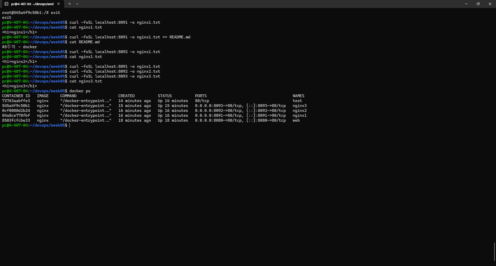
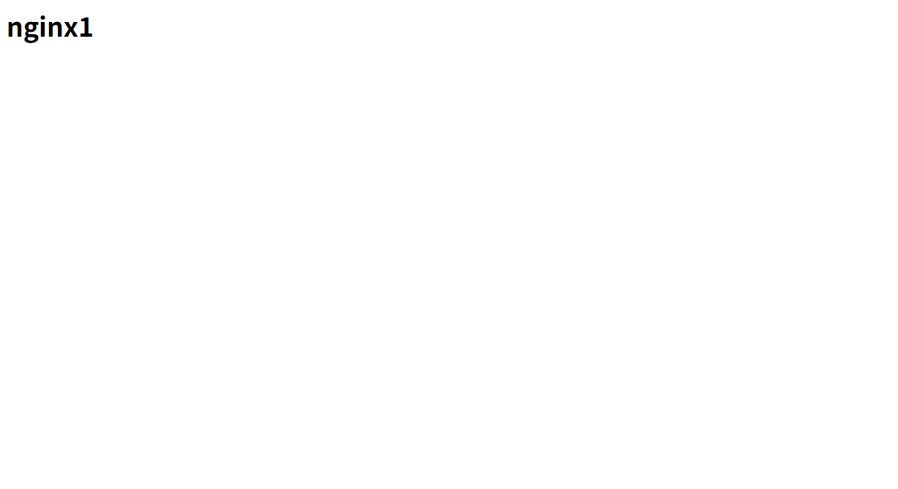

# 5주차: Docker 실행 환경 및 nginx 컨테이너 실습

## 1. 오늘 배운 핵심 내용
- Docker 버전과 실행 환경 확인
- `hello-world` 이미지로 컨테이너 실행 확인
- nginx 컨테이너를 실행하고 포트 연결 확인
- 실습 결과를 파일로 남기고 Issue, PR로 작업 정리

---

## 2. Docker 실행 환경 확인
```bash
docker --version
docker info
docker run hello-world
```
- `docker-version.txt`: Docker version 29.8.0 확인
- `docker-info.txt`: Docker Desktop, WSL2 기반 Linux 환경 확인
- `docker-run-hello-world.txt`: `Hello from Docker!` 출력 확인

`docker info`와 `docker ps`는 저장한 시점이 다르다. info에는 실행 중인 컨테이너가 0개이고, ps에는 web이 실행 중인 상태로 남아 있다.

## 3. nginx 실행 및 응답 확인
```bash
docker run -d -p 8080:80 --name web nginx
docker ps
curl -I http://localhost:8080
```
| 항목 | 의미 | 남겨 둔 결과 |
| :--- | :--- | :--- |
| `-d` | 백그라운드에서 실행 | `docker-ps.txt`의 Up 상태 |
| `-p 8080:80` | 호스트 8080번을 컨테이너 80번에 연결 | `0.0.0.0:8080->80/tcp` |
| `--name web` | 컨테이너 이름 지정 | NAMES 항목의 web |
| `curl -I` | 응답 헤더 확인 | `curl-result.txt`의 `HTTP/1.1 200 OK` |

컨테이너가 실행 중인지 확인하는 것과 웹 요청이 정상적으로 처리되는지 확인하는 것은 따로 확인해야 한다.

## 4. 추가로 남겨 둔 파일
- `nginx1.txt`, `nginx2.txt`, `nginx3.txt`: 각각 `<h1>nginx1</h1>` 등의 문구가 들어 있다.
- `images/2.png`: `curl` 결과와 `docker ps`가 함께 보이는 실습 캡처



캡처에서 `nginx1`, `nginx2`, `nginx3`이 각각 호스트 포트 8091, 8092, 8093에 실행 중인 것을 확인할 수 있다. `.

### 혼자서 해보기

| 할 일 | 직접 확인한 결과 |
| :--- | :--- |
| Docker 확인 | 클라이언트와 서버 모두 29.8.2, 저장 드라이버는 overlayfs. `docker run --rm hello-world`에서 `Hello from Docker!`를 확인했다. |
| nginx 3개 실행 | `docker ps`에서 nginx1·nginx2·nginx3이 각각 8091·8092·8093번 포트로 `Up` 상태였다. |
| 컨테이너 안의 index.html 수정 | 각 컨테이너에서 `docker exec`로 문구를 바꿨다. 아래에 세 주소의 응답을 적었다. |
| 브라우저 캡처 | [nginx1](images/nginx1.png), [nginx2](images/nginx2.png), [nginx3](images/nginx3.png) |
| 실습 후 정리 | `docker rm -f nginx1 nginx2 nginx3 web`로 이번에 만든 네 컨테이너를 제거했다. |

```text
127.0.0.1:8091 -> <h1>nginx1</h1>
127.0.0.1:8092 -> <h1>nginx2</h1>
127.0.0.1:8093 -> <h1>nginx3</h1>
```



## 5. Issue부터 Merge까지
- [Issue #2: 5주차 docker 실행 환경 확인및 nginx 실행](https://github.com/jaewonlee02/devops/issues/2)
- 작업 브랜치: `docs/issue-2-docker-start`
- [PR #3: 5주차:Docker](https://github.com/jaewonlee02/devops/pull/3)
- PR에 Docker 실행 환경, hello-world 실행, `docker ps -a`, curl 검증 내용을 적었다.
- PR 본문에 `Close #2`를 넣어 Issue를 연결했다.
- PR #3은 `hi` 브랜치에 Merge되었고, 커밋 `4481f64`로 남아 있다.
