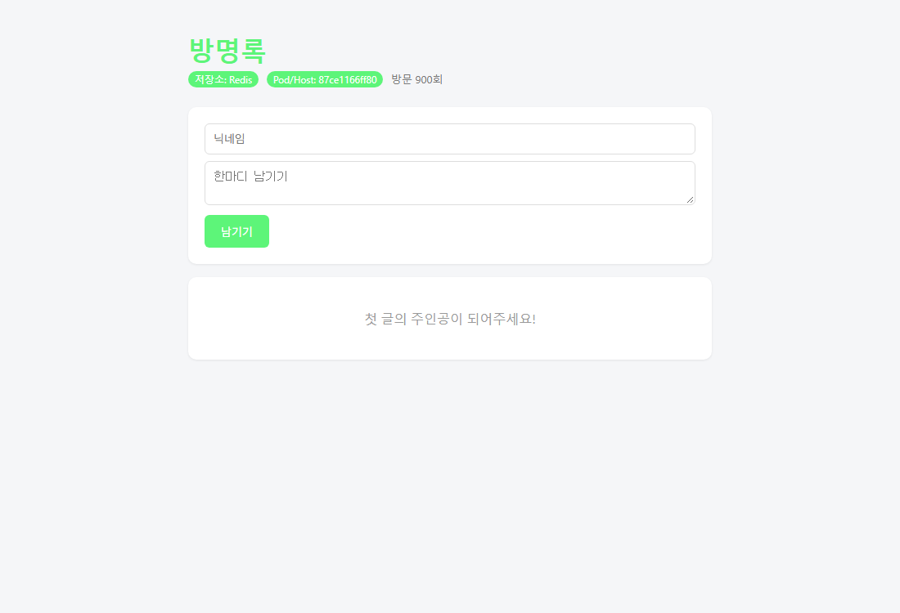

# 7주차: Docker Compose 및 web 확장 정리

## 1. 오늘 배운 핵심 내용
- 여러 컨테이너 구성을 compose.yaml로 관리
- Redis로 방명록 데이터 공유
- 볼륨으로 데이터 보관
- .env로 환경변수 분리
- healthcheck와 시작 순서
- nginx를 통한 요청 전달과 web=3 확장

---

## 2. 지난주와 달라진 점
지난주 방명록은 Redis 없이 실행하면 메모리 모드였다. 메모리에만 저장한 글은 컨테이너를 다시 시작하면 사라진다. web을 여러 개 띄우면 각 web의 메모리도 따로 있어서 어느 web에 접속했는지에 따라 보이는 글이 달라질 수 있다. 그래서 방명록 앱과 저장소 역할을 나누고, Redis 컨테이너에 데이터를 저장한다.

앱과 DB를 한 컨테이너에 같이 넣으면 한쪽 문제를 처리할 때 다른 쪽에도 영향을 준다. 각각 따로 실행하면 역할을 구분해서 확인하기 쉽다. 다만 직접 `docker run`을 여러 번 입력하면 포트나 환경변수 설정을 빠뜨릴 수 있다. 이 구성을 `compose.yaml`에 적어 두면 같은 설정으로 다시 실행하거나 팀원에게 전달할 수 있다.

## 3. 서비스 구성


```text
브라우저 localhost:8080
          |
       nginx:80
          |
     web:5000 3개
          |
       redis:6379
          |
      redis-data 볼륨
```

| 서비스 | 역할 | 호스트 포트 |
| :--- | :--- | :--- |
| nginx | 외부 요청을 받고 web으로 전달 | 8080:80 |
| web | Flask 방명록 앱 실행 | 호스트에 게시하지 않음 |
| redis | 방명록과 방문자 수 공유 | 호스트에 게시하지 않음 |

메모에서 정리한 핵심은 `services` 아래에 web과 redis 같은 역할을 나누고, `build: .`은 Dockerfile로 빌드하며 `image: redis:7-alpine`은 준비된 이미지를 사용한다는 것이다. `volumes`에서는 redis-data를 선언해 Redis의 `/data`에 연결한다.

Compose 네트워크에서는 서비스 이름으로 서로 찾을 수 있다. web의 REDIS_HOST는 localhost가 아니라 redis이다. 컨테이너 안의 localhost는 그 컨테이너 자신이기 때문이다.

## 4. .env 설정과 실행
```bash
# 저장소 최상위 폴더에서 이동
cd guestbook
cp .env.example .env
# .env를 열어 REDIS_PASSWORD 값을 정한 뒤 실행
docker compose config --quiet
docker compose up -d --build --scale web=3
docker compose ps
docker compose logs web
```

.env.example은 설정할 변수의 이름을 공유하는 파일이고, 실제 비밀번호를 적은 .env는 Git에 올리지 않는다. .dockerignore에도 .env가 있어 이미지에 복사하지 않는다. Compose의 .env는 설정값 치환에 사용하며, 앱에 전달할 변수는 compose.yaml의 environment에 지정한다.

`docker compose config --quiet`는 구성 문법과 변수 치환을 검사한다. 검사가 통과해도 앱의 정상 응답까지 확인한 것은 아니다.

## 5. 볼륨과 데이터 보관

| 명령어 | 컨테이너와 네트워크 | redis-data 볼륨 |
| :--- | :--- | :--- |
| `docker compose down` | 종료 및 제거 | 유지 |
| `docker compose down -v` | 종료 및 제거 | 함께 제거 |

수업 예제 Redis는 `/data`에 볼륨을 연결하고 AOF를 사용한다. 따라서 일반 down 뒤에 같은 프로젝트로 다시 up하면 저장 데이터를 다시 사용할 수 있다. `down -v`는 방명록 데이터까지 지우므로 초기화가 필요한 경우에만 사용한다.

메모리 모드에서는 web마다 데이터가 따로 있다. Redis를 사용하면 여러 web이 같은 방명록과 방문자 수를 공유한다.

## 6. healthcheck와 depends_on
```yaml
# compose.yaml 일부
web:
  depends_on:
    redis:
      condition: service_healthy
```

Redis가 시작된 것과 요청을 받을 준비가 된 것은 다르다. service_healthy로 Redis의 점검이 통과한 뒤 web을 시작하게 한다. nginx도 web이 healthy 상태가 된 뒤 시작하도록 구성되어 있다.

| 점검 | 의미 |
| :--- | :--- |
| Redis ping | Redis가 요청에 응답하는지 확인 |
| `/healthz` | 앱의 생존 확인용 응답 |
| `/readyz` | Redis 연결을 포함해 요청 처리 준비 여부 확인 |
| interval: 5s | 5초 간격으로 점검 |
| timeout: 3s | 점검이 3초 안에 끝나지 않으면 실패 |
| retries: 5 | 연속 실패 횟수 기준 |

healthcheck는 상태를 확인하는 기능이다. unhealthy 표시만으로 Compose가 자동 복구하거나 서버를 옮겨 주지는 않는다.

## 7. web 3개 실행과 nginx
```bash
docker compose up -d --scale web=3
docker compose ps
curl http://localhost:8080
```

web마다 `8080:5000`을 지정하면 같은 호스트 포트를 쓰려고 하여 충돌한다. 그래서 호스트의 8080번은 nginx가 받고, web은 내부 5000번을 사용한다. expose는 사용할 포트 정보를 적는 것이며 같은 네트워크의 통신을 열기 위한 필수 설정은 아니다.

nginx.conf에서는 Docker DNS인 127.0.0.11과 valid=5s를 사용한다. web이라는 서비스 이름을 다시 조회할 수 있도록 proxy_pass에 변수를 사용한다. 컨테이너를 다시 만들면 IP가 바뀔 수 있기 때문이다.

브라우저를 여러 번 새로고침하며 화면 hostname을 컨테이너 ID와 비교하는 방식으로 요청 전달을 확인한다. 매번 정확하게 번갈아 바뀐다고 보장할 수는 없다.

## 8. 48쪽 호기심 문제: web 하나를 멈추면?
`docker stop`으로 직접 중지한 web은 restart: unless-stopped만으로 자동 재시작하지 않는다. 남은 web이 요청을 받아도 web 개수는 줄어든 상태이다.

```bash
docker compose ps -q web
docker stop <확인한_web_ID_하나>
docker compose ps

docker compose up -d --scale web=3
```


이 방법은 필요할 때 사람이 명령을 다시 실행하는 것이다. 실행 개수를 반복 확인하는 [셸 스크립트 예시](../report/code/maintain-web3.sh)는 보고서에 따로 정리했다. 이 스크립트도 컴퓨터 자체가 꺼지면 동작하지 않는다.

## 9. 혼자 해보기 


| 기록할 항목 | 실제 결과 |
| :--- | :--- |
| `docker compose ps`와 healthy | `guestbook-redis-1`과 `guestbook-web-1`·`2`·`3`이 모두 `Up (healthy)`로 표시됐다. nginx도 `Up` 상태였다. |
| web 3개의 hostname | nginx를 거쳐 `/healthz`를 24번 조회하니 `04be7bc33fbc`, `0a32d2b0f738`, `2e348bfc5863` 세 hostname이 나왔다. 아래는 컨테이너를 다시 만든 뒤의 브라우저 캡처다. |
| `down`과 `down -v` 비교 | Redis에 글 1개를 넣고 일반 down/up하니 1개가 유지됐다. 실습 볼륨을 `down -v`로 지우고 다시 up하니 0개였다. `/api/entries`로 확인했다. |
| 메모리 모드 비교 | 글 1개를 넣고 해당 컨테이너를 재시작하니 0개로 초기화됐다. |
| web 3개 복구 | `docker stop guestbook-web-2` 후 실행 수가 2개였다. `docker compose up -d --no-deps --no-build --scale web=3 web` 후 다시 3개였다. |

24회 조회 기록은 볼륨 실험 전의 web ID이고, 아래 캡처는 `down -v` 후 다시 만든 web의 ID이다. 컨테이너를 다시 만들면 ID가 바뀌므로 두 기록의 값도 다르다.





방문 횟수 표시는 템플릿에서 실제 방문 수에 100을 곱한 값이다.
